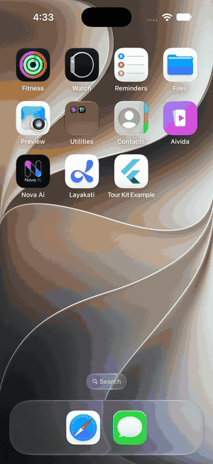

# tour_kit

Spotlight tutorials for Flutter apps: highlight a widget, explain it, move on.
Scrolling screens, tabs, other screens, right-to-left languages and your own theme all work.



| Package | What it is |
| --- | --- |
| [`tour_kit`](packages/tour_kit) | The tutorial library. |
| [`tour_kit_shared_preferences`](packages/tour_kit_shared_preferences) | Remembers which tours the user has seen, using `shared_preferences`. |

## Try it

```bash
cd packages/tour_kit/example
flutter run
```

Add `--dart-define=AUTOPLAY=true` to let the tour advance by itself.

## Develop

```bash
cd packages/tour_kit && flutter pub get && flutter analyze && flutter test
cd ../tour_kit_shared_preferences && flutter pub get && flutter analyze && flutter test
```

## License

MIT, see [LICENSE](LICENSE).
