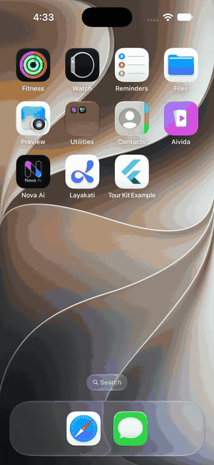
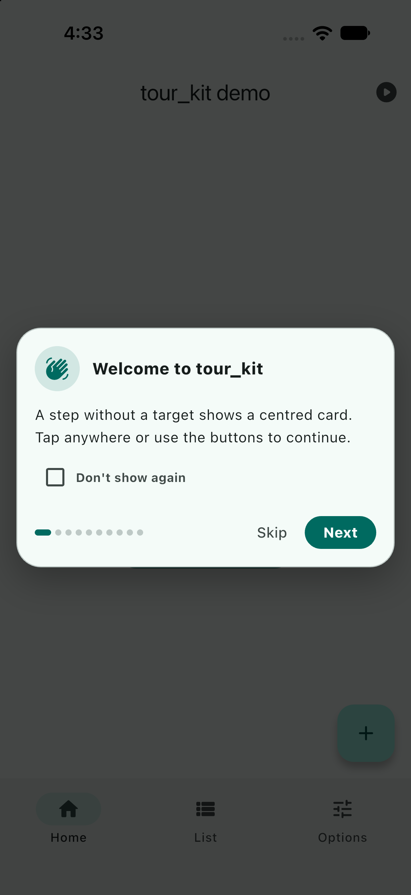
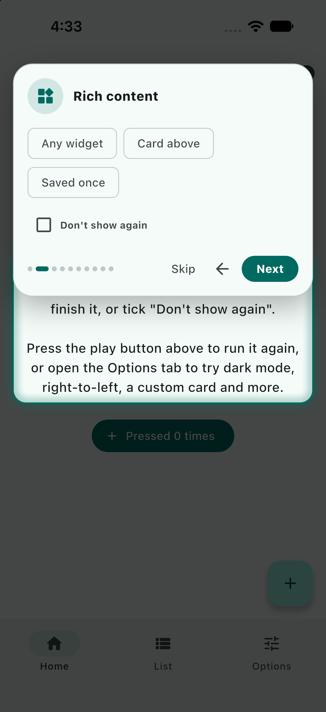
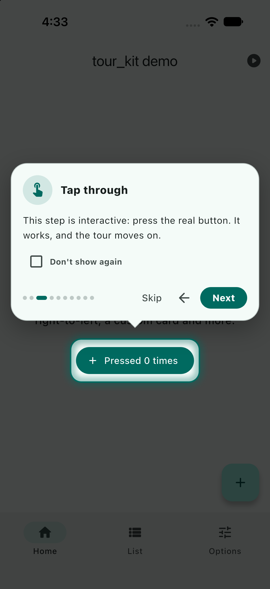
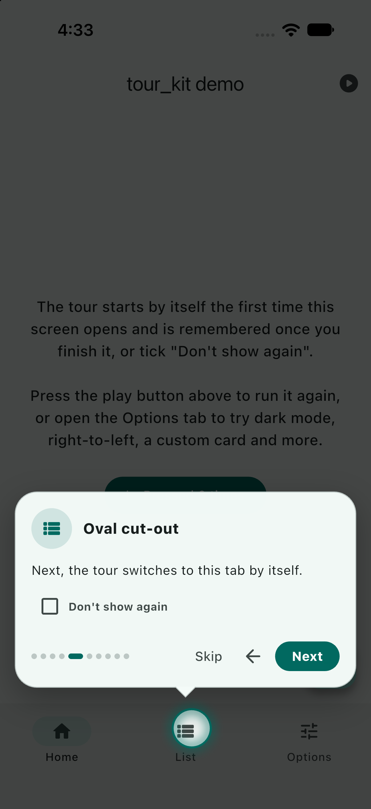
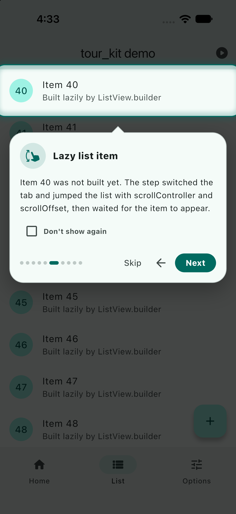
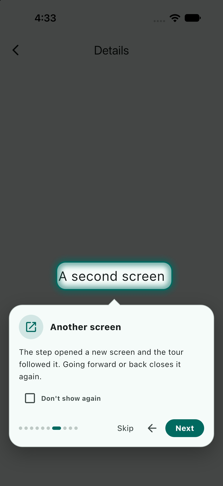

# tour_kit

Spotlight tutorials for any Flutter app: highlight a widget, explain it, move to the next step.
Works with scrolling screens, tabs, right-to-left languages, and any theme.

> Status: 0.1.0, local package. Not yet published.



## Screenshots

| Welcome | Rich content | Tap through |
| --- | --- | --- |
|  |  |  |

| Oval and pointer | Lazy list | Another screen |
| --- | --- | --- |
|  |  |  |

The `example/` app runs all of this. Start it with `flutter run`, or with
`--dart-define=AUTOPLAY=true` to let the tour advance by itself.

## Quick start

```dart
// 1. Mark the widgets you want to explain.
TourTarget(id: 'add-button', child: FloatingActionButton(...));

// 2. Run a tour whenever you like.
final outcome = await Tour.show(
  context,
  steps: const [
    TourStep(
      target: 'add-button',
      icon: Icons.add,
      title: 'Add an item',
      body: 'Tap here to create your first item.',
    ),
  ],
);
```

`Tour.show` resolves with a `TourResult`: `outcome` (`completed`, `skipped`, or `unavailable` when there are no steps or a tour is already running), `lastIndex` (the last step shown) and `dontShowAgain`.

## Show a tour once

```dart
TourLauncher(
  tourId: 'home',
  storage: myStorage,           // any TourStorage; MemoryTourStorage ships in the box
  steps: homeSteps,
  child: const HomeScreen(),
)
```

`TourLauncher` waits for the first frame (`delay`, default 650 ms), skips if `storage` says the tour is done,
shows the tour, then calls `storage.markCompleted`. To manage "done" yourself, leave `storage` null,
control `enabled`, and use `onShown`.

Persisting to `shared_preferences`:

```dart
class PrefsTourStorage implements TourStorage {
  PrefsTourStorage(this.prefs);
  final SharedPreferences prefs;
  static const _key = 'tours_done';

  Set<String> get _done => (prefs.getStringList(_key) ?? []).toSet();

  @override
  Future<bool> isCompleted(String id) async => _done.contains(id);

  @override
  Future<void> markCompleted(String id) =>
      prefs.setStringList(_key, {..._done, id}.toList());

  @override
  Future<void> reset([String? id]) => id == null
      ? prefs.remove(_key)
      : prefs.setStringList(_key, (_done..remove(id)).toList());
}
```

## Steps

| Field | What it does |
| --- | --- |
| `target` / `targetKey` | A `TourTarget` id, or any `GlobalKey`. No target shows a centred card. |
| `title`, `body`, `icon`, `content` | Card content. `content` replaces `body` with any widget. |
| `shape`, `padding` | Cut-out shape (`rect`, `rounded`, `circle`, `oval`) and spacing around the target. |
| `placement` | `auto`, `above`, `below`, `center`. |
| `scroll`, `scrollAlignment`, `scrollTo` | Scroll the target into view, or supply your own scroll logic. |
| `onEnter`, `onExit` | Async hooks. Switch tabs, open drawers, scroll lists. |
| `waitFor` | How long to wait for the target to appear after `onEnter` (default 1.5 s). |
| `skipIfMissing` | Skip the step when the target never appears (default `true`). |
| `interactive` | Let taps inside the highlight reach the real widget underneath. |
| `tapTargetToContinue`, `onTargetTap` | Move on, or run a callback, when the highlight is tapped. |
| `scrollController`, `scrollOffset` | Jump a scroll view before looking for the target (lazy lists). |
| `hookTimeout` | How long to wait for `onEnter`/`onExit` (default 2 s). |
| `theme`, `cardBuilder` | Override the tour's theme or card for this step only. |

### Switching tabs

```dart
TourStep(
  target: 'settings-theme',
  title: 'Theme',
  onEnter: (_) => tabController.animateTo(2),
)
```

The step waits for the target to appear in the new tab before highlighting it.

### Lazy lists

Items that a lazy `ListView.builder` has not built yet cannot be found by themselves.
Tell the step where to scroll first:

```dart
TourStep(
  target: 'item-60',
  scroll: false,
  scrollController: controller,
  scrollOffset: 60 * itemExtent,
)
```

### Steps on another screen

A step's `onEnter` can open a screen. The tour stays on top of it while it waits for the target.
Use a block body, because `Navigator.push` returns a future that only completes when the screen closes
(otherwise the tour carries on after `hookTimeout`):

```dart
TourStep(
  target: 'details-title',
  onEnter: (context) {
    Navigator.of(context).push(MaterialPageRoute(builder: (_) => const Details()));
  },
  onExit: (context) => Navigator.of(context).pop(),
)
```

### Letting the user try the real widget

```dart
TourStep(
  target: 'counter-button',
  interactive: true,          // taps reach the button
  tapTargetToContinue: true,  // and the tour moves on
)
```

### Controlling a running tour

```dart
Tour.controller?.next();   // back(), goTo(3), skip(), finish()
Tour.isActive;
```

## Customising

```dart
Tour.show(
  context,
  steps: steps,
  theme: TourTheme(
    scrimColor: Colors.black87,
    ringColor: Colors.amber,
    cardColor: Colors.white,
    cardRadius: 16,
    titleStyle: TextStyle(fontSize: 18),
    holeShape: TourShape.circle(),
    iconBuilder: (context, icon) => MyBadge(icon),
  ),
  strings: TourStrings(next: 'Weiter', back: 'Zurück', skip: 'Überspringen', done: 'Fertig'),
  options: TourOptions(progress: TourProgressStyle.counter, scrimTap: TourScrimTap.none),
  cardBuilder: (context, data) => MyCard(data),   // replace the whole card
);
```

`TourCardData` gives a custom card the step, position (`index`, `count`, `isFirst`, `isLast`),
the theme, strings and options, plus `next()`, `back()` and `skip()`.

### Other options

* `TourTheme.pointer`: a small arrow from the card to the highlight.
* `TourTheme.pulse`: a gently pulsing outline (off when the system asks to reduce motion).
* `TourOptions.offerDontShowAgain` and `TourStrings.dontShowAgain`: a checkbox on the default card.
  `TourResult.dontShowAgain` reports it, and `TourLauncher` stores the tour as seen when it is ticked,
  even with `markCompletedOnSkip: false`.

## Behaviour notes

* The tour lives in the root overlay, not in a route. The Android back button (and the iOS back swipe)
  skips it, using the same pop-interception as `PopScope` on the current route, so app bars do not
  grow a back arrow. Arrow keys, Enter and Escape work on desktop and web (`TourOptions.keyboard`).
* The overlay stays above screens pushed while it is showing. If you push a screen from outside the tour,
  call `Tour.bringToFront()`.
* Targets that are not visible, such as in a hidden `IndexedStack` tab or an `Offstage`, are treated as
  missing until `onEnter` reveals them.
* The highlight follows rotation, keyboard and window-size changes, and the card stays above the
  on-screen keyboard.
* Reduce-motion is honoured: fades and the pulse are skipped.
* If the overlay is disposed mid-tour, `Tour.show` still completes (as `skipped`).
* Text directions are honoured; the default card mirrors in right-to-left.
* Using the same `TourTarget` id twice on one screen is an error from Flutter (duplicate key). Keep ids unique.

## Testing

Pump frames after starting a tour; step changes wait on `endOfFrame` and polling timers.
`MemoryTourStorage` keeps tests independent of disk state.
